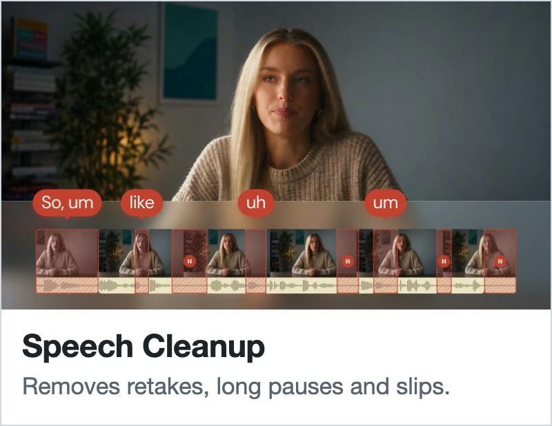
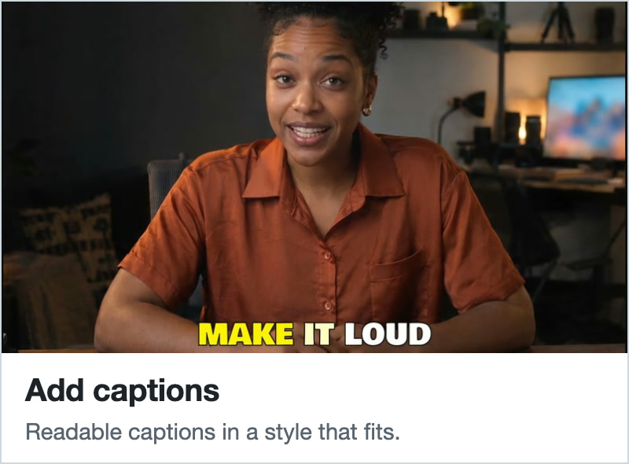
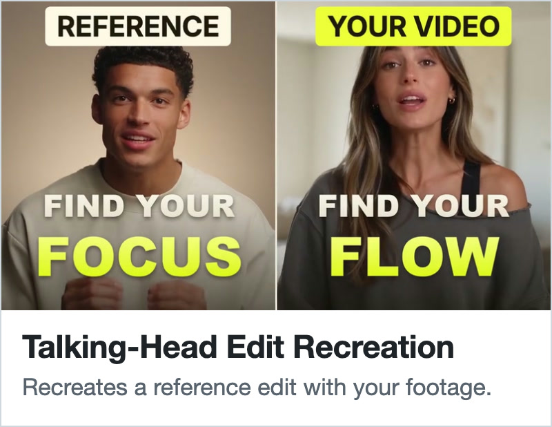
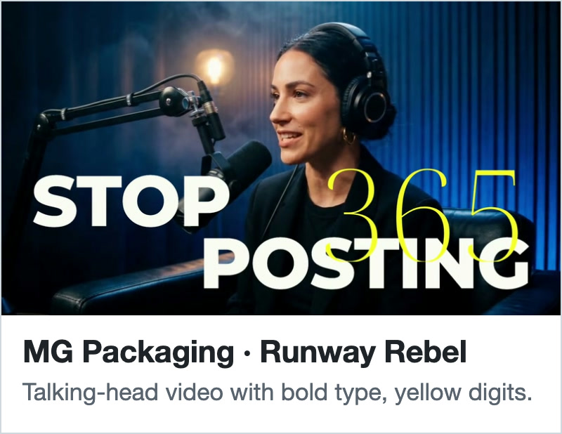
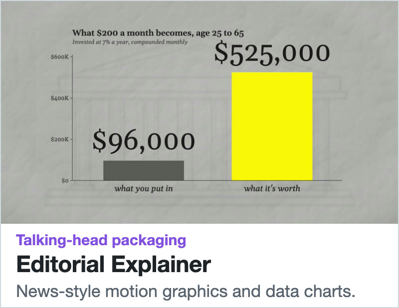

<h1 align="center"><picture><source media="(prefers-color-scheme: dark)" srcset="docs/media/brand/chatcut-logotype-dark-mode.svg"></picture> AI&nbsp;Video&nbsp;Editor</h1>

<p align="center">
  <a href="https://www.producthunt.com/products/chatcut-ai-video-editor?utm_source=badge-top-post-badge&amp;utm_medium=badge&amp;utm_campaign=badge-chatcut-2"><picture><source media="(prefers-color-scheme: dark)" srcset="https://chatcut.io/producthunt/badge-dark.svg"></picture></a>
</p>

<p align="center">
  <a href="https://github.com/ChatCut-Inc/agent-plugin"></a>
  <a href="https://github.com/ChatCut-Inc/agent-plugin/releases/latest"></a>
  <a href="https://github.com/ChatCut-Inc/agent-plugin/blob/main/LICENSE"></a>
  <a href="https://discord.com/invite/sMjQPvwZTT"></a>
  <a href="https://glama.ai/mcp/connectors/io.chatcut/chatcut"></a>
</p>

**ChatCut is an AI video editor for agents: an MCP server and plugin that lets Codex, ChatGPT, Claude Code, Cursor, Grok Bot, Gemini CLI, Google Antigravity, Kimi Work, WorkBuddy, Doubao Work and Qwen Work edit your own footage, add captions and subtitles, remove silences and filler words, create motion graphics, generate video, voiceovers and music, and export an editable timeline.**

<div align="center">

[Website](https://chatcut.io/?utm_source=github&utm_medium=readme&utm_campaign=agent-plugin) · [Skills](https://chatcut.io/skills?utm_source=github&utm_medium=readme&utm_campaign=agent-plugin) · [Docs](https://chatcut.io/docs?utm_source=github&utm_medium=readme&utm_campaign=agent-plugin) · [Setup guide](https://chatcut.io/desktop?utm_source=github&utm_medium=readme&utm_campaign=agent-plugin) · [Pricing](https://chatcut.io/pricing?utm_source=github&utm_medium=readme&utm_campaign=agent-plugin) · [Discord](https://discord.com/invite/sMjQPvwZTT) · [X](https://x.com/chatcutapp)

**Works with**

[](https://chatcut.io/chatgpt-plugin?utm_source=github&utm_medium=readme&utm_campaign=agent-plugin)
[](https://chatcut.io/chatgpt-plugin?utm_source=github&utm_medium=readme&utm_campaign=agent-plugin)
[](https://chatcut.io/claude-code-plugin?utm_source=github&utm_medium=readme&utm_campaign=agent-plugin)
[](https://chatcut.io/grok-plugin?utm_source=github&utm_medium=readme&utm_campaign=agent-plugin)
[](https://chatcut.io/antigravity-plugin?utm_source=github&utm_medium=readme&utm_campaign=agent-plugin)
[](https://chatcut.io/workbuddy?utm_source=github&utm_medium=readme&utm_campaign=agent-plugin)<br>
[](#web-setup)
[](#web-setup)
[](./kimi/README.md)
[](./doubao/README.md)
[](./qwen/README.md)

</div>

<!-- Hero demo video: once it is uploaded, put its GitHub user-attachments URL on its own line here. -->

<p align="center">
  <a href="https://chatcut.io/skills/speech-cleanup?utm_source=github&amp;utm_medium=readme&amp;utm_campaign=agent-plugin"></a>
  <a href="https://chatcut.io/viralvideocloner?utm_source=github&amp;utm_medium=readme&amp;utm_campaign=agent-plugin"></a>
  <a href="https://chatcut.io/skills/add-captions?utm_source=github&amp;utm_medium=readme&amp;utm_campaign=agent-plugin"></a>
  <a href="https://chatcut.io/skills/recreate-a-video?utm_source=github&amp;utm_medium=readme&amp;utm_campaign=agent-plugin"></a>
  <a href="https://chatcut.io/skills/mg-packaging-runway-rebel?utm_source=github&amp;utm_medium=readme&amp;utm_campaign=agent-plugin"></a>
  <a href="https://chatcut.io/skills/mg-packaging-editorial-explainer?utm_source=github&amp;utm_medium=readme&amp;utm_campaign=agent-plugin"></a>
</p>

## Install

ChatCut's plugin (MCP) works with ChatCut Desktop on your computer (recommended; your media stays local) or with hosted ChatCut Web. Find your agent below and follow its row.

| Agent | How to install | Setup guide |
| --- | --- | --- |
| Codex | `Read ChatCut.io/desktop to install ChatCut` | [Codex guide](https://chatcut.io/chatgpt-plugin?utm_source=github&utm_medium=readme&utm_campaign=agent-plugin) |
| ChatGPT | `Read ChatCut.io/desktop to install ChatCut` in the desktop app, or open **Plugins** in the sidebar, search for **ChatCut** and select **Install** | [ChatGPT guide](https://chatcut.io/chatgpt-plugin?utm_source=github&utm_medium=readme&utm_campaign=agent-plugin) |
| Claude Code | `Read ChatCut.io/desktop to install ChatCut` | [Claude Code guide](https://chatcut.io/claude-code-plugin?utm_source=github&utm_medium=readme&utm_campaign=agent-plugin) |
| Cursor | Add ChatCut's MCP server to `~/.cursor/mcp.json` and sign in | [Cursor guide](#web-setup) |
| Grok Bot | `Read ChatCut.io/grok to connect the ChatCut app` | [Grok Bot guide](https://chatcut.io/grok-plugin?utm_source=github&utm_medium=readme&utm_campaign=agent-plugin) |
| Gemini CLI | `gemini extensions install https://github.com/ChatCut-Inc/agent-plugin` | [Gemini CLI guide](#web-setup) |
| Google Antigravity | `Read ChatCut.io/antigravity to install ChatCut` | [Antigravity guide](https://chatcut.io/antigravity-plugin?utm_source=github&utm_medium=readme&utm_campaign=agent-plugin) |
| Kimi Work | Type `/`, choose **Plugin Builder** and send it `https://github.com/ChatCut-Inc/agent-plugin/tree/main/kimi`. Install it under **Plugins → Personal** (插件 → 个人), then select **Login** on the ChatCut connector card | [Kimi Work guide](./kimi/README.md) |
| WorkBuddy | `Read ChatCut.io/desktop to install ChatCut`, or open **Experts · Skills · Connectors** (专家·技能·连接器) → **Experts** (专家), search **ChatCut**, open the official **ChatCut 视频剪辑师** expert and select **Summon** (召唤) | [WorkBuddy guide](https://chatcut.io/workbuddy?utm_source=github&utm_medium=readme&utm_campaign=agent-plugin) · [WorkBuddy expert guide](./workbuddy/README.md) |
| Doubao Work (豆包工作) | In the sidebar, open **Plugins · Skills** (插件 · 技能) → **Plugins** (插件), search **ChatCut** and open it, select **Install** (安装) on its ChatCut connector, then **Use in chat** (在对话中使用). It installs ChatCut Desktop if needed | [Doubao Work guide](./doubao/README.md) |
| Qwen Work (千问办公) | Open **Skills & extensions → Connectors → Market**, select **+** next to **ChatCut**, then **Install ChatCut** | [Qwen Work guide](./qwen/README.md) |

### Desktop setup

In Codex, the ChatGPT desktop app, Claude Code or another local agent, paste `Read ChatCut.io/desktop to install ChatCut`. The agent installs ChatCut Desktop, opens sign-in and connects itself to Desktop's local `chatcut_desktop` MCP server.

To install Desktop yourself, run the official installer on the macOS or Windows computer. It needs a graphical desktop but not Node.js or npm, so a Linux or remote agent can't install Desktop there:

```sh
# macOS 13 or newer (Apple Silicon or Intel)
curl -fsSL https://chatcut.io/install.sh | sh
```

```powershell
# Windows 10 or newer (x64)
irm https://chatcut.io/install.ps1 | iex
```

Google Antigravity can also install the Desktop package directly. Then ask “Install ChatCut on this computer”. It installs and connects ChatCut Desktop only; see the [Antigravity Desktop guide](./antigravity-desktop/README.md).

```sh
agy plugin install https://github.com/ChatCut-Inc/agent-plugin/tree/main/antigravity-desktop
```

Video recreation needs Desktop: its bundled `video-gen` Skill calls `submit_video_remake` to keep a reference video's motion and timing with your person or product, and asks before spending credits ([guide](https://chatcut.io/viralvideocloner?utm_source=github&utm_medium=readme&utm_campaign=agent-plugin)).

### Web setup

Web projects and their media aren't migrated to Desktop, and connecting Desktop to the same agent may replace its hosted connection.

Claude Code (`claude mcp login` needs Claude Code 2.1.210 or newer; [full guide](https://chatcut.io/web-plugin/claude?utm_source=github&utm_medium=readme&utm_campaign=agent-plugin), [agent-executable copy](./docs/claude-code-web-install.md)):

```sh
claude plugin marketplace add https://github.com/ChatCut-Inc/agent-plugin.git#main
claude plugin install chatcut@chatcut-inc
claude mcp login plugin:chatcut:chatcut
```

Codex CLI (in the Codex desktop app, use its bundled Codex CLI; [full guide](https://chatcut.io/web-plugin/chatgpt?utm_source=github&utm_medium=readme&utm_campaign=agent-plugin)):

```sh
codex plugin marketplace add https://github.com/ChatCut-Inc/agent-plugin.git --ref main
codex plugin marketplace list   # note the marketplace name
codex plugin add chatcut@<marketplace>
codex mcp login chatcut
```

Gemini CLI:

```sh
gemini extensions install https://github.com/ChatCut-Inc/agent-plugin
```

Cursor: add the server to `~/.cursor/mcp.json` and sign in when Cursor asks:

```json
{
  "mcpServers": {
    "chatcut": {
      "url": "https://api.chatcut.io/api/external-mcp/mcp"
    }
  }
}
```

Grok Bot and Antigravity Web: see the [Grok Bot Web guide](./grok/README.md) and the [Antigravity Web guide](./antigravity/README.md). Grok Bot signs in from its Plugins screen; in Antigravity, select **Customizations → Authenticate** next to the ChatCut MCP server.

Other MCP clients that support remote servers with OAuth can connect to `https://api.chatcut.io/api/external-mcp/mcp` and sign in with a ChatCut account.

## Everything ChatCut can make

ChatCut edits your own footage and generates new media, and the result is an editable timeline. Under the hood the plugins import media, change a project timeline, create motion graphics, generate assets, transcribe audio, add captions, export videos, and verify that edits are visible in the editor. Items marked *(Desktop)* need ChatCut Desktop. Generation uses ChatCut credits, and the agent asks before spending them.

**Editing**

- Talking-head cleanup: remove silences, filler words, repeated takes and stumbles, and tighten the pacing.
- Text-based editing: edit the video by editing its transcript.
- Highlight clips and short cuts from long interviews, podcasts and lectures.
- Multicam sync: line up camera angles and separate audio recordings, then cut to whoever is speaking.
- Beat-synced cuts and automatic scene-cut detection *(Desktop)*.
- B-roll, background music, markers and multiple timeline versions, including vertical 9:16 cuts for TikTok, Instagram Reels and YouTube Shorts.
- Scene-by-scene video analysis, and checks that each edit is visible in the editor.

**Captions and subtitles**

- Word-timed transcripts and subtitles, including Chinese.
- Animated caption styles, and custom kinetic typography *(Desktop)*.
- Subtitle translation, and SRT or TXT subtitle files.

**Voice, music and sound**

- Text-to-speech voiceovers, and voice clones with the speaker's consent.
- Music generation, instrumental or with vocals.
- Sound effects.
- Speech cleanup: remove background noise, hum and room echo.
- Short crossfades that smooth the audio at every cut.
- Audio effects such as EQ, filters, delay and reverb *(Desktop)*.

**Generation**

- AI video from text, images or reference frames, with models such as Seedance and Kling.
- AI images, thumbnails and covers, with models such as GPT Image and Nano Banana.
- Talking-photo presenter videos (digital human / AI avatar).
- Lip sync for existing footage.
- Video translation and dubbing into other languages, with or without lip sync.
- Viral video remakes that keep a reference video's motion and timing with your own person or product *(Desktop)*.
- Batches of up to 50 image, video, voice, music and sound jobs in one step *(Desktop)*.

**Motion graphics and design**

- Motion graphics: title cards, lower thirds, animated overlays and full-frame animations.
- Motion graphic templates: apply published ones, or save your own for reuse in other projects.
- Design styles that keep a brand's colors, fonts and logos consistent across captions and graphics.
- Google Fonts and bundled Chinese fonts.

**Effects and look**

- Transitions, visual effects and custom shaders.
- Color grading, LUTs, masks and background removal *(Desktop)*.
- Beauty and body retouch *(Desktop)*.

**Media in**

- Stock video, photos, music and sound effects from Pexels, Pixabay, Unsplash and Freesound.
- Product details, brand assets and screenshots collected from a web page.
- Videos imported from a link *(Desktop)*.
- Screen recordings with click and cursor data for demo videos *(Desktop)*.
- Dropbox for importing media and X for posting finished videos *(Desktop)*. Google Drive, YouTube, TikTok and Instagram connectors open as each platform approves them.

**Saved across projects**

- Characters: people you feature again, with photos, a description and a voice, for consistent generated shots and presenter videos *(Desktop)*.
- Products: photos, selling points, price and specs for product ads, so scripts stick to what you saved *(Desktop)*.
- Memory of your preferences, and Workflow Skills that save a working editing process for reuse.

**Writing and planning** *(Desktop)*

- Screenplays and scripts with scene outlines, production breakdowns and shot lists.
- Scripts export to Final Draft (FDX), Fountain, PDF or Word, and shot lists to CSV or HTML.

**Export and handoff**

- MP4 video, MP3, WAV, FLAC or AAC audio, and PNG stills.
- Premiere Pro and DaVinci Resolve XML.
- 剪映专业版 (Jianying Pro) and CapCut drafts, transparent ProRes 4444 motion graphics, 4K and HDR video, and Markdown, PDF or Word documents *(Desktop)*.

**Video types:** talking-head videos, podcasts and interviews, tutorials and lectures, product demos and app promos, UGC-style product ads, short-form videos, viral video remakes, presenter and avatar videos, screen-recorded demos *(Desktop)*, multicam shoots, music videos cut to the beat *(Desktop)* and translated videos.

## What Is Included

- `codex/` - the Codex plugin package.
- `claude/` - the Claude Code plugin package.
- `grok/` - the Grok Bot plugin package (hidden from Cursor).
- `cursor/` - the Cursor plugin package (hidden from Grok Bot); its skills and assets symlink to `grok/`.
- `antigravity-desktop/` - the Google Antigravity Desktop-only package: one Skill that installs ChatCut Desktop and connects `chatcut_desktop`, with no MCP server of its own; see [its README](./antigravity-desktop/README.md).
- `antigravity/` - the Google Antigravity hosted Web plugin package.
- `antigravity/plugin.json` - Antigravity plugin metadata.
- `antigravity/mcp_config.json` - Antigravity MCP server configuration.
- `kimi/` - the Kimi Work plugin package, with mandatory basics, core craft skills, and in-app browser adapters; see [its package and migration guide](./kimi/README.md).
- `workbuddy/` - the WorkBuddy expert package for the hosted Web plugin; see [its README](./workbuddy/README.md).
- `doubao/` - the Doubao Work (豆包工作) Skill package for ChatCut Desktop; see [its README](./doubao/README.md).
- `qwen/` - the Qwen Work (千问办公) expert kit for the hosted Web plugin; see [its README](./qwen/README.md).
- `chatcut-desktop-codex-plugin/` - the store-facing, skill-only package that
  helps Codex install and connect the signed ChatCut Desktop app.
- `codex-store/` - builds the OpenAI plugin directory ZIP from `codex/`; see
  [its README](./codex-store/README.md).
- `codex/.codex-plugin/plugin.json` - Codex plugin metadata.
- `claude/.claude-plugin/plugin.json` - Claude Code plugin metadata.
- `grok/.cursor-plugin/plugin.json` and `cursor/.cursor-plugin/plugin.json` - Grok Bot and Cursor plugin metadata, both listed in `.cursor-plugin/marketplace.json`.
- `gemini-extension.json` - Gemini CLI extension manifest (hosted MCP only; install with `gemini extensions install https://github.com/ChatCut-Inc/agent-plugin`).
- `codex/.mcp.json` - Codex MCP server configuration.
- `codex/skills/` - host adapters and canonical shared craft skills for this repository.
- Other packages use relative symlinks for identical skills, references, helper scripts, licenses and assets; host-specific files stay separate. All targets are inside this repository, not another checkout.
- `codex/assets/` - canonical plugin icons and brand assets.

Clone the complete repository with symlink support. When distributing a standalone package, dereference its symlinks so the bundle contains its shared resources (`codex-store/build.mjs` does this for the OpenAI directory ZIP). Live installation of each host's package still needs host-specific verification.

## Requirements

- A ChatCut account.
- Codex with plugin support, Claude Code 2.x (CLI or desktop app), Grok Bot, Cursor, Google Antigravity (App, CLI, or IDE), Kimi Work, WorkBuddy, Doubao Work or Qwen Work.
- Access to a ChatCut project you want to edit.

## Example Prompts

After installing and authenticating the plugin, ask in your own words, for example:

- `Cut this talking-head video tighter and add captions.`
- `Add subtitles to my video and export a vertical version.`
- `Add a simple motion graphic overlay.`
- `Generate a voiceover and background music.`
- `帮我把这段口播剪干净，加上字幕。`

## Repository

The public plugin repository is:

```text
https://github.com/ChatCut-Inc/agent-plugin.git
```

## Support

For product information, visit [chatcut.io](https://chatcut.io/?utm_source=github&utm_medium=readme&utm_campaign=agent-plugin).

## License

Apache-2.0; see [LICENSE](./LICENSE).
